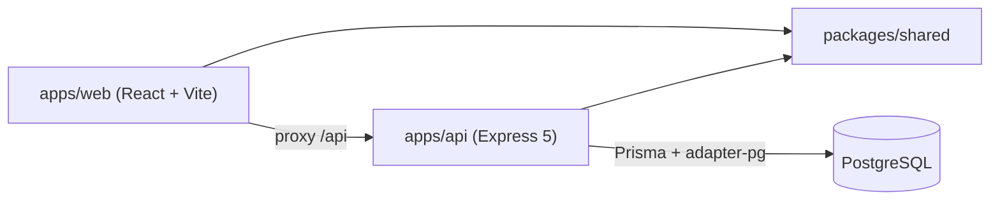
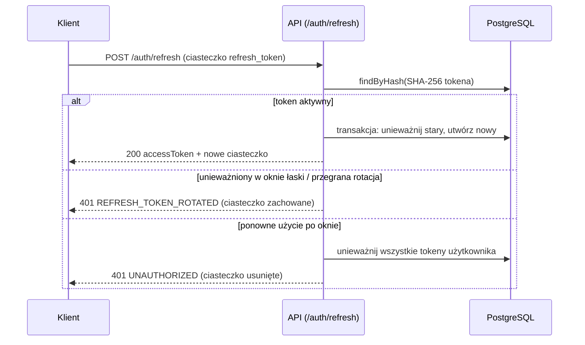
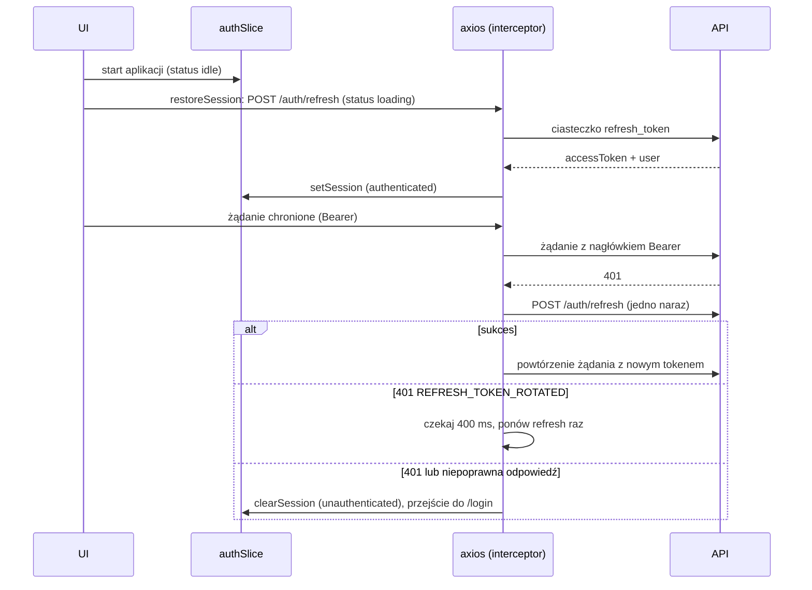

# Architektura

Stan: M1b — szkielet oraz uwierzytelnianie (backend i frontend). Uzasadnienia decyzji: `docs/DECISIONS.md`.

## Moduły

### packages/shared
Schematy Zod (`healthResponseSchema`, `errorResponseSchema`, uwierzytelnianie w `schemas/auth.ts`), `WS_EVENTS` (robocze), `boardRoom()`. Udostępniany przez warunek `@streamline/source` (ADR-005).

### apps/api (Controller → Service → Repository)
- `app.ts` — `createApp({ config, logger, db })` (helmet, cors, pino-http, JSON 1 MB, cookie-parser, trasy, not-found, error-handler); zależności (repozytoria, serwisy, `requireAuth`) składane ręcznie; `server.ts` — nasłuch i łagodne zamykanie.
- `config/env.ts` — walidacja Zod: `NODE_ENV`, `PORT` (4000), `DATABASE_URL`, `CORS_ORIGIN` (lista po przecinku, domyślnie `http://localhost:5173`), `LOG_LEVEL` oraz zmienne uwierzytelniania (`docs/PROJECT_STATE.md`).
- `routes/`, `controllers/`, `services/`, `repositories/` (`db.ts`, `user`, `refresh-token`), serwisy `auth`, `token` (jose, SHA-256), `password` (bcryptjs), middleware `require-auth` i `rate-limit`, `errors/app-error.ts`, `middleware/`.

### apps/web
Tailwind 4 (`@tailwindcss/vite`), shadcn/ui (new-york, neutral; `input`, `label`, `card` pisane ręcznie w tym samym stylu). Serwer deweloperski Vite przekazuje `/api` do API.
- `routes.tsx` — drzewo tras: `AuthBootstrap` (układ główny) → `GuestRoute` (`/login`, `/register`) oraz `ProtectedRoute` → `AppLayout` → `/` (`HomePage`).
- `stores/auth.ts` — Zustand: `user`, `accessToken` (tylko pamięć), `status` (`idle` | `loading` | `authenticated` | `unauthenticated`), `sessionEpoch` (zwiększany przy `clearSession`).
- `lib/api.ts` — `createApiClient({ rotatedRetryDelayMs, sleep, adapter })` zwraca `{ api, refreshSession, waitForPendingRefresh }`; `lib/api-error.ts` — `getApiErrorInfo` (schemat `errorResponseSchema`).
- `features/auth/` — `authApi.ts` (login, register, logout), `session.ts` (`restoreSession`), `useSessionRestore.ts`, `AuthBootstrap`, `ProtectedRoute`, `GuestRoute`, `LoginPage`, `RegisterPage`, `AuthCard`, `AuthField`, `authErrorMessage.ts`, `redirect.ts` (`getRedirectTarget` przyjmuje tylko ścieżki wewnątrz aplikacji, odrzuca `//` i `/\`).
- `components/layout/` — `AppLayout` (nagłówek z nazwą, e-mailem i przyciskiem „Log out”), `FullPageLoader`.
- `test/` — `mockAdapter.ts` (ręczny adapter axios), `renderApp.tsx`, `fixtures.ts`.

## Przepływy danych
Przepływ M0: `HomePage` → `useApiHealth` → `GET /api/health` (proxy Vite) → `health.routes` → `health.controller` → `health.service` → `{ "status": "ok" }`.

Przepływ odświeżania sesji (M1a):

Przepływ uwierzytelniania we frontendzie (M1b, ADR-016–018):

Błędy sieci, 5xx i 429 podczas odświeżania nie kończą sesji. Wynik odświeżenia rozpoczętego w poprzedniej sesji (inny `sessionEpoch`) jest odrzucany. Wylogowanie czeka na zakończenie trwającego odświeżenia (`waitForPendingRefresh`), wysyła `POST /auth/logout` i zawsze czyści stan lokalny.

Docelowy przepływ (ADR-003): UI → REST → baza → zdarzenie Socket.io do pokoju `board:<id>` → pozostali klienci.

## Narzędzia i CI
ESLint (jedna konfiguracja), Prettier, Husky + lint-staged, Vitest. GitHub Actions (`.github/workflows/ci.yml`): push/PR do `main` — instalacja z zamrożonym lockfile, `prisma generate`, lint, typecheck, test, format:check, build; usługa PostgreSQL.
