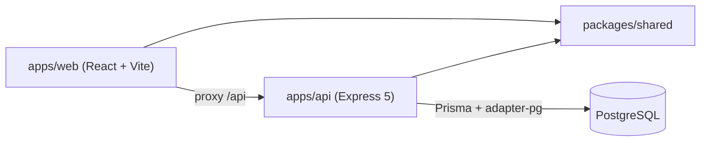
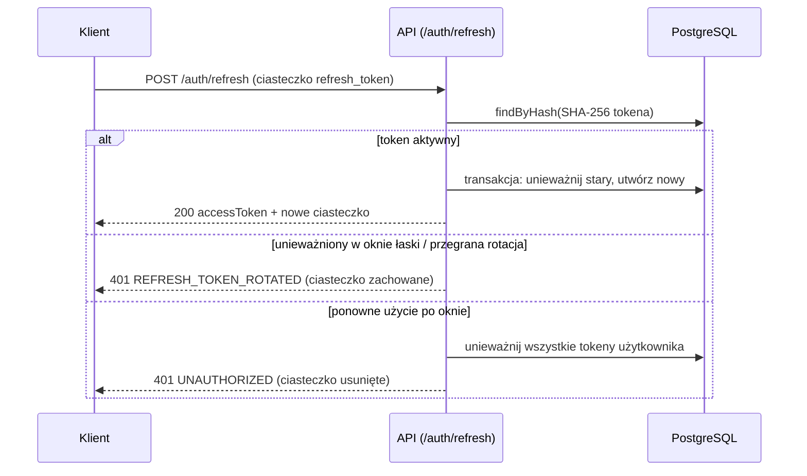
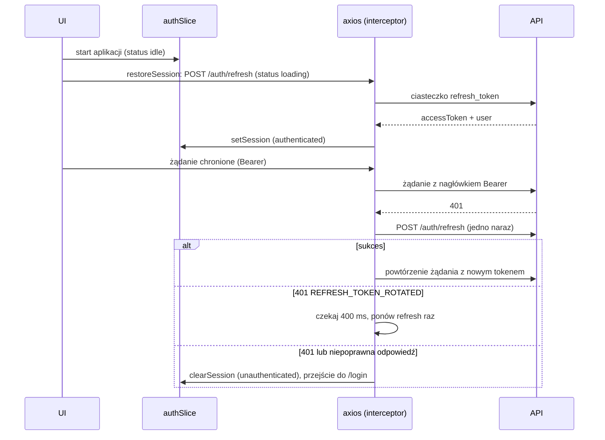
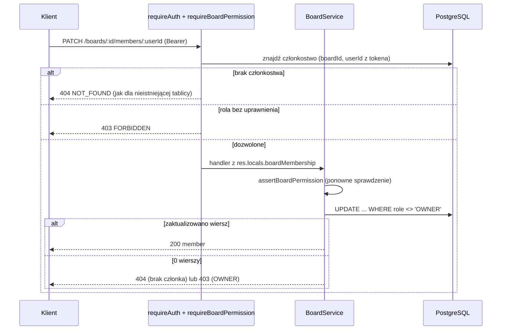
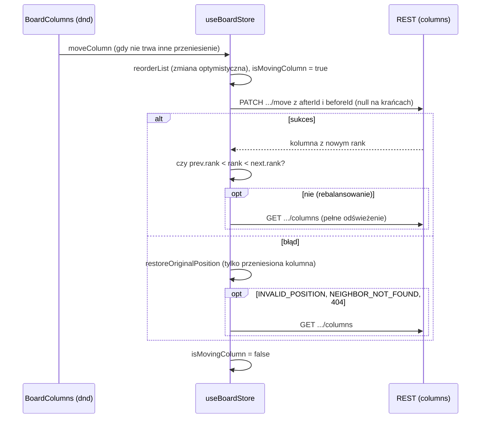

# Architektura

Stan: M2d — szkielet, uwierzytelnianie, tablice, członkowie, role, kolumny oraz frontend tablic i kolumn. Uzasadnienia decyzji: `docs/DECISIONS.md`.

## Moduły



### packages/shared
Schematy Zod (`healthResponseSchema`, `errorResponseSchema`, uwierzytelnianie w `schemas/auth.ts`), `WS_EVENTS` (robocze), `boardRoom()`. Udostępniany przez warunek `@streamline/source` (ADR-005).

Moduł `src/rank/` (M2a, ADR-022–024): `keys.ts` (alfabet, `isValidRank`, `RankError`, `rankSchema`, `RANK_MAX_LENGTH`), `lexorank.ts` (`rankFirst`, `rankBetween`, `rankAfter`, `rankBefore`, `rankSequenceBetween`), `rebalance.ts` (`needsRebalance`, `rebalanceRanks`), `index.ts`. Funkcje są czyste i bez zależności; klucze wyznacza wyłącznie serwer na podstawie zapisanych sąsiadów. Moduł tablic (M2b): `schemas/board.ts` (schematy, typy, `BOARD_ERROR_CODES`) i `permissions.ts` (`BOARD_ACTIONS`, `BOARD_PERMISSIONS`, `hasBoardPermission`, `canManageMember`, `canLeaveBoard`) — czysta macierz uprawnień współdzielona przez API i (od M2d) frontend. Poza `src/`: `test-utils/prng.ts` (generator mulberry32 do testów) i `bench/rank.bench.ts` (benchmark).

### apps/api (Controller → Service → Repository)
- `app.ts` — `createApp({ config, logger, db })` (helmet, cors, pino-http, JSON 1 MB, cookie-parser, trasy, not-found, error-handler); zależności (repozytoria, serwisy, `requireAuth`) składane ręcznie; `server.ts` — nasłuch i łagodne zamykanie.
- `config/env.ts` — walidacja Zod: `NODE_ENV`, `PORT` (4000), `DATABASE_URL`, `CORS_ORIGIN` (lista po przecinku, domyślnie `http://localhost:5173`), `LOG_LEVEL` oraz zmienne uwierzytelniania (`docs/PROJECT_STATE.md`).
- `routes/` (`auth`, `board`, `health`), `controllers/`, `services/`, `repositories/` (`db.ts`, `user`, `refresh-token`, `board`, `board-member`, `prisma-errors.ts`), serwisy `auth`, `token` (jose, SHA-256), `password` (bcryptjs), middleware `require-auth`, `require-board-permission` i `rate-limit`, serwisy `board` i `board-access`, `errors/app-error.ts`, `middleware/`.

### apps/web
Tailwind 4 (`@tailwindcss/vite`), shadcn/ui (new-york, neutral; `input`, `label`, `card` pisane ręcznie w tym samym stylu). Serwer deweloperski Vite przekazuje `/api` do API.
- `routes.tsx` — drzewo tras: `AuthBootstrap` (układ główny) → `GuestRoute` (`/login`, `/register`) oraz `ProtectedRoute` → `AppLayout` → `/` (przekierowanie do `/boards`), `/boards` (`BoardsPage`), `/boards/:boardId` (`BoardPage`).
- `stores/auth.ts` — Zustand: `user`, `accessToken` (tylko pamięć), `status` (`idle` | `loading` | `authenticated` | `unauthenticated`), `sessionEpoch` (zwiększany przy `clearSession`).
- `lib/api.ts` — `createApiClient({ rotatedRetryDelayMs, sleep, adapter })` zwraca `{ api, refreshSession, waitForPendingRefresh }`; `lib/api-error.ts` — `getApiErrorInfo` (schemat `errorResponseSchema`).
- `features/auth/` — `authApi.ts` (login, register, logout), `session.ts` (`restoreSession`), `useSessionRestore.ts`, `AuthBootstrap`, `ProtectedRoute`, `GuestRoute`, `LoginPage`, `RegisterPage`, `AuthCard`, `AuthField`, `authErrorMessage.ts`, `redirect.ts` (`getRedirectTarget` przyjmuje tylko ścieżki wewnątrz aplikacji, odrzuca `//` i `/\`).
- `stores/board.ts` (M2d, ADR-034, ADR-035) — `useBoardStore` (Zustand): lista tablic, otwarta tablica (`board`, `columns`, `members`), `isMovingColumn`, `notice`. Liczniki generacji odrzucają spóźnione odpowiedzi (także `renameBoard`); stan jest zerowany przy zmianie `sessionEpoch` lub użytkownika w `authSlice`. Akcje: ładowanie, tworzenie, zmiana nazwy i usuwanie tablic; kolumny (tworzenie, nazwa z optymistycznym zapisem i wycofaniem, ustawienia — wysyłane tylko zmienione pola, usuwanie, `moveColumn`); członkowie (dodanie, zmiana roli, usunięcie, opuszczenie).
- `features/boards/` (M2d): `BoardsPage` (lista, tworzenie, zmiana nazwy, usuwanie), `BoardPage` (tablica, stan 404, komunikat `BOARD_BUSY`), `BoardColumns` (poziomy `DragDropContext`/`Droppable`), `BoardColumn` (nazwa, kategoria i licznik WIP `n / limit` z `badges.tsx`, czerwony po przekroczeniu; liczba kart z propa `getCardCount`, domyślnie 0 do czasu M3), `ColumnTitleEditor` (Enter/Escape), `AddColumnForm`, `ColumnSettingsDialog`, `MembersDialog`, `ConfirmDialog`; logika czysta: `columnOrder.ts` (`compareRanks`, `sortByRank`, `reorderList`, `getMoveNeighbors`, `restoreOriginalPosition`, `rankFitsAt`), `columnDrag.ts` (`getColumnMove`), `columnSettings.ts`, `boardErrorMessage.ts`; klienty HTTP `boardsApi.ts`, `columnsApi.ts`; `labels.ts`, `paths.ts`. Kontrolki są ukrywane przez `hasBoardPermission`, `canManageMember` i `canLeaveBoard` z `shared`.
- `components/ui/` — dodane: `dialog`, `alert-dialog`, `badge`, `checkbox`, `native-select` (ADR-036); `test/setup.ts` zawiera stub `ResizeObserver`.
- `components/layout/` — `AppLayout` (nagłówek: link z nazwą aplikacji do `/boards`, nazwa użytkownika, przycisk wylogowania), `FullPageLoader`.
- `test/` — `mockAdapter.ts` (ręczny adapter axios), `renderApp.tsx`, `fixtures.ts`.

## Przepływy danych
Przepływ M0: `GET /api/health` (proxy Vite) → `health.routes` → `health.controller` → `health.service` → `{ "status": "ok" }` (od M2d frontend nie wywołuje już tego endpointu).

Przepływ odświeżania sesji (M1a):



Przepływ uwierzytelniania we frontendzie (M1b, ADR-016–018):



Błędy sieci, 5xx i 429 podczas odświeżania nie kończą sesji. Wynik odświeżenia rozpoczętego w poprzedniej sesji (inny `sessionEpoch`) jest odrzucany. Wylogowanie czeka na zakończenie trwającego odświeżenia (`waitForPendingRefresh`), wysyła `POST /auth/logout` i zawsze czyści stan lokalny.

### Kontrola uprawnień do tablicy (M2b, ADR-025–027)

Dwie warstwy: (1) czysta macierz `BOARD_PERMISSIONS` w `shared`; (2) w API middleware `requireBoardPermission(action)` ładuje członkostwo (`BoardAccessService.require`) i zapisuje je w `res.locals.boardMembership`; serwis `board.service` dodatkowo wywołuje `assertBoardPermission`, więc poprawność nie zależy tylko od konfiguracji tras. Mutacje członków są warunkowe (`role <> OWNER`) w repozytorium.



Walidacja ciała (Zod) następuje po sprawdzeniu roli. Zdarzenia Socket.io dla tablic i członków nie są jeszcze emitowane.

### Kolumny: przypisywanie `rank` i współbieżność (M2c, ADR-028–032)

Trasy `/boards/:boardId/columns` są montowane w routerze tablic (`createColumnRouter`, `mergeParams`) i korzystają z tego samego `requireBoardPermission`. `column.service` liczy `rank` wyłącznie na serwerze z zapisanych sąsiadów (`resolveInsertIndex` → `rankBetween`); klient podaje tylko `afterId`/`beforeId`. Wszystkie zapisy kolumn (z wyjątkiem zmiany nazwy) idą w transakcji, która najpierw ustawia `lock_timeout` (2 s, lokalnie dla transakcji) i blokuje wiersz tablicy; transakcja ma też limity `maxWait` 2 s i `timeout` 5 s (ADR-033):
- `FOR SHARE` — wstawienie i przeniesienie (wykonują się równolegle; kolizję tego samego klucza wykrywa ograniczenie unikalności `(boardId, rank)`),
- `FOR NO KEY UPDATE` — rebalansowanie, usunięcie i zmiana ustawień (wyłączne wobec innych zapisów kolumn tej tablicy).

```mermaid
sequenceDiagram
  participant C as Klient
  participant S as ColumnService
  participant D as PostgreSQL
  C->>S: PATCH /boards/:id/columns/:colId/move {afterId, beforeId}
  loop do 5 prób, każda we własnej transakcji (READ COMMITTED)
    S->>D: BEGIN; SELECT ... FROM Board FOR SHARE (lub NO KEY UPDATE)
    S->>D: lista kolumn tablicy (ORDER BY rank)
    S->>S: indeks wstawienia + rankBetween(poprzedni, następny)
    alt klucz dłuższy niż RANK_MAX_LENGTH i blokada współdzielona
      S->>D: ROLLBACK; ponowna próba z blokadą wyłączną
    else klucz dłuższy niż RANK_MAX_LENGTH i blokada wyłączna
      S->>D: UPDATE Column ... FROM unnest(ids, ranks) (rebalansowanie)
      S->>D: COMMIT
    else zwykły zapis
      S->>D: UPDATE Column SET rank
      alt naruszenie unikalności (P2002)
        D-->>S: błąd; ROLLBACK; kolejna próba z łagodniejszym sprawdzaniem sąsiadów
      else
        S->>D: COMMIT
      end
    end
  end
  S-->>C: 200 {column}, 409 RANK_CONFLICT po 5 próbach lub 503 BOARD_BUSY (55P03/P2028, bez ponowienia)
```

Rebalansowanie nigdy nie podnosi trzymanej blokady (restart próby zamiast „upgrade”), więc nie powstaje zakleszczenie. Usunięcie i zmiana ustawień biorą blokadę wyłączną, co czyni inwariant „co najmniej jedna kolumna `DONE`” odpornym na wyścigi. Tworzenie tablicy wstawia 4 domyślne kolumny w tej samej transakcji (`board.repository`: zagnieżdżony `create`). Przekroczenie limitu czasu (PostgreSQL 55P03 lub Prisma P2028) repozytorium zgłasza jako `BoardBusyError`, serwis jako `ServiceUnavailableError`, a klient dostaje 503 `BOARD_BUSY`. Zdarzenia Socket.io dla kolumn nie są jeszcze emitowane; po rebalansowaniu zmieniają się klucze wielu kolumn, a odpowiedź REST zawiera jedną.

### Karty: tworzenie, przeniesienie, limit WIP i kolejność blokad (M3a, ADR-043–045, ADR-049)

Trasy `/boards/:boardId/cards` (`createCardRouter`, `mergeParams`) używają tego samego `requireBoardPermission` i wspólnych pomocników zapisu z `rank` (`services/ranked-write.ts`) oraz runnera transakcji (`repositories/board-transaction.ts`) co kolumny. `card.service` liczy `rank` na serwerze z sąsiadów KOLUMNY DOCELOWEJ, a klucz karty (`SL-12`) składa przy odczycie z `Board.key` i `Card.number`. Stała kolejność blokad: **wiersz tablicy → wiersz karty → wiersz kolumny** (członkostwo, jeśli potrzebne, przed kartą). Transakcje zaczynają od `lock_timeout` 2 s, więc przeciążenie daje 503 `BOARD_BUSY`.

- **Utworzenie**: blokada wyłączna tablicy (`FOR NO KEY UPDATE`), bo numer pochodzi z `UPDATE ... RETURNING` licznika `nextCardNumber` (blokada współdzielona zakleszczałaby się na tym `UPDATE`).
- **Przeniesienie**: blokada współdzielona tablicy (równoległe przeniesienia różnych kart), następnie blokada wiersza karty i, gdy karta wchodzi do kolumny ze ścisłym WIP, blokada wiersza kolumny przed `COUNT`. Za długi `rank` → restart próby z blokadą wyłączną i rebalansowanie kolumny (jak w ADR-030).
- **Zmiana ustawień kolumny i usunięcie kolumny**: blokada wyłączna tablicy, więc przy trzymanej blokadzie współdzielonej limit WIP jest stabilny, a niepusta kolumna nie zniknie w trakcie dodawania karty.
- **Przypisanie osoby**: blokada `FOR SHARE` wiersza członkostwa; usunięcie członka usuwa członkostwo i odpina jego karty w jednej transakcji.

```mermaid
sequenceDiagram
  participant C as Klient
  participant S as CardService
  participant D as PostgreSQL
  C->>S: PATCH /boards/:id/cards/:cardId/move {columnId, afterId, beforeId}
  loop do 5 prób, każda we własnej transakcji
    S->>D: BEGIN; lock_timeout; SELECT Board FOR SHARE
    S->>D: SELECT Card FOR NO KEY UPDATE (zakres: boardId)
    S->>D: kolumna docelowa; karty kolumny (ORDER BY rank)
    S->>S: indeks wstawienia (resolveInsertIndex)
    alt ta sama pozycja
      S->>D: COMMIT (bez zapisu i bez przejścia)
    else kolumna docelowa ze ścisłym WIP i zmiana kolumny
      S->>D: SELECT Column FOR NO KEY UPDATE; COUNT kart
      alt liczba >= wipLimit
        S-->>C: 409 WIP_LIMIT_EXCEEDED (ROLLBACK)
      end
    end
    S->>S: rankBetween(poprzedni, następny)
    alt klucz za długi, blokada współdzielona
      S->>D: ROLLBACK; próba z blokadą wyłączną
    else klucz za długi, blokada wyłączna
      S->>D: UPDATE Card ... FROM unnest (rebalansowanie)
    end
    S->>D: UPDATE Card SET columnId, rank
    opt zmiana kolumny
      S->>D: INSERT CardTransition (from, to, movedBy)
    end
    alt kolizja Card_columnId_rank_key (P2002)
      D-->>S: błąd; ROLLBACK; kolejna próba (łagodniejsze sprawdzanie sąsiadów)
    else
      S->>D: COMMIT
    end
  end
  S-->>C: 200 {card}, 409 RANK_CONFLICT po 5 próbach lub 503 BOARD_BUSY
```

Odczyt listy (`GET .../cards`) wykonuje jedna transakcja `REPEATABLE READ` (klucz tablicy, kolumny, karty), więc karta nigdy nie wskazuje kolumny spoza listy. `PATCH` i `DELETE` karty nie biorą blokady tablicy (nie zmieniają `rank` ani liczby kart w kolumnie); usunięcie przechodzi przez runner transakcji (`lock_timeout`). Transakcje kart są zbudowane z tych samych elementów co kolumn: `createBoardTransactionRunner` z opcjonalnym ograniczeniem rank (`Card_columnId_rank_key`), `withRankRetry`, `busyToServiceUnavailable`.

Zdarzenia Socket.io dla kart nie są jeszcze emitowane (planowane po zapisie: `UI → REST → baza → zdarzenie do pokoju board:<id> → pozostali klienci`). Dane dla analityki przepływu powstają od razu: każde wejście karty do kolumny zapisuje wiersz `CardTransition` w tej samej transakcji co zmiana `columnId`.

### Klucz tablicy i klucz karty (M3a, ADR-046)

`board.service.create` pobiera klucze tablic właściciela (`listKeysForOwner`) i wybiera pierwszego wolnego kandydata z `boardKeyCandidates(name)` (`packages/shared/src/board-key.ts`); jeśli równoległe żądanie tego samego użytkownika zajęło klucz (naruszenie `Board_ownerId_key_key`), próbuje następnego (do 5 razy, potem 409 `BOARD_KEY_TAKEN`). `PATCH /boards/:boardId` zmienia nazwę i/lub klucz. Klucz karty nie jest zapisywany — składa go `formatCardKey(Board.key, Card.number)`, więc zmiana klucza tablicy zmienia klucze kart bez migracji danych, a `GET .../cards/:cardKey` z nieaktualnym prefiksem daje 404.

Docelowy przepływ (ADR-003): UI → REST → baza → zdarzenie Socket.io do pokoju `board:<id>` → pozostali klienci.

### Przeniesienie kolumny w kliencie (M2d, ADR-034, ADR-035)



Zdarzeń Socket.io jeszcze nie ma: zmiany innych użytkowników (w tym ról) są widoczne po ponownym załadowaniu widoku.

## Narzędzia i CI
ESLint (jedna konfiguracja), Prettier, Husky + lint-staged, Vitest. GitHub Actions (`.github/workflows/ci.yml`): push/PR do `main` — instalacja z zamrożonym lockfile, `prisma generate`, lint, typecheck, test, format:check, build; usługa PostgreSQL.
