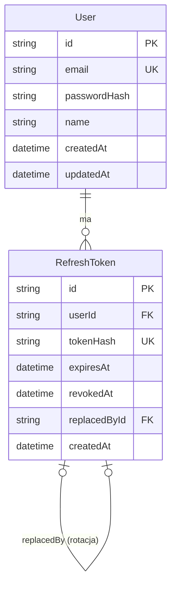

# Baza danych

Stan: M1a — modele `User` i `RefreshToken`, jedna migracja. Wstępny model docelowy: `docs/TECH_STACK.md`, sekcja 5.

## Diagram ER

## Konfiguracja
- PostgreSQL 18 uruchamiany przez `docker-compose.yml` (`postgres:18-alpine`); dane dostępowe z root `.env` (`POSTGRES_USER`, `POSTGRES_PASSWORD`, `POSTGRES_DB`, `POSTGRES_PORT`).
- Prisma 7.10.1: adres bazy w `apps/api/prisma.config.ts` (zmienna `DATABASE_URL` z `apps/api/.env`).
- Generator `prisma-client`, wyjście `apps/api/src/generated/prisma` (poza repozytorium; generowany w `postinstall` pakietu API).
- Połączenie przez `@prisma/adapter-pg`; klient tworzony w `apps/api/src/repositories/db.ts` (`createDbClient`), połączenie leniwe; w `server.ts` trafia do `createApp({ config, logger, db })`.
- Tylko repozytoria korzystają z Prisma.
- Testy integracyjne API używają osobnej bazy `streamline_test` (ADR-015). Adres: `DATABASE_URL_TEST` albo `DATABASE_URL` z dopiskiem `_test` do nazwy bazy; baza jest tworzona i migrowana automatycznie (`prisma migrate deploy` w `globalSetup`), a tabele są czyszczone (`TRUNCATE`) przed każdym testem. Nazwa bazy testowej musi kończyć się na `_test`. CI przekazuje `DATABASE_URL_TEST` i używa usługi PostgreSQL.

## Modele

### User
| Pole | Typ | Uwagi |
|---|---|---|
| `id` | String | PK, `cuid()` |
| `email` | String | unikalny; zapisywany znormalizowany (przycięty, małe litery) |
| `passwordHash` | String | hash bcrypt (bcryptjs) |
| `name` | String | |
| `createdAt` | DateTime | domyślnie `now()` |
| `updatedAt` | DateTime | `@updatedAt` |

Relacja: `refreshTokens` (1:N). Indeks: unikalny `User_email_key`.

### RefreshToken
| Pole | Typ | Uwagi |
|---|---|---|
| `id` | String | PK, `cuid()` |
| `userId` | String | FK → `User.id`, `onDelete: Cascade` |
| `tokenHash` | String | unikalny; SHA-256 (hex) nieprzezroczystego tokena — sam token nie jest przechowywany |
| `expiresAt` | DateTime | |
| `revokedAt` | DateTime? | ustawiane przy rotacji, wylogowaniu lub masowym unieważnieniu |
| `replacedById` | String? | unikalny FK → `RefreshToken.id` (`onDelete: SetNull`); token wydany w zamian przy rotacji |
| `createdAt` | DateTime | domyślnie `now()` |

Indeksy: unikalne `tokenHash` i `replacedById`, zwykły `userId`. Para `replacedById` ustawione i `revokedAt` niepuste odróżnia token wymieniony przy rotacji od unieważnionego wylogowaniem — to podstawa wykrywania ponownego użycia (ADR-013).

## Migracje
| Migracja | Zawartość |
|---|---|
| `20261111010926_auth_users_refresh_tokens` | tabele `User` i `RefreshToken`, indeksy, klucze obce |

Polecenia: `pnpm --filter @streamline/api db:migrate` (tworzy i stosuje migrację w środowisku deweloperskim), `prisma migrate deploy` (stosuje istniejące migracje; używane przez testy).

## Znane braki
- Wygasłe i unieważnione wiersze `RefreshToken` nie są usuwane (brak zadania czyszczącego).
