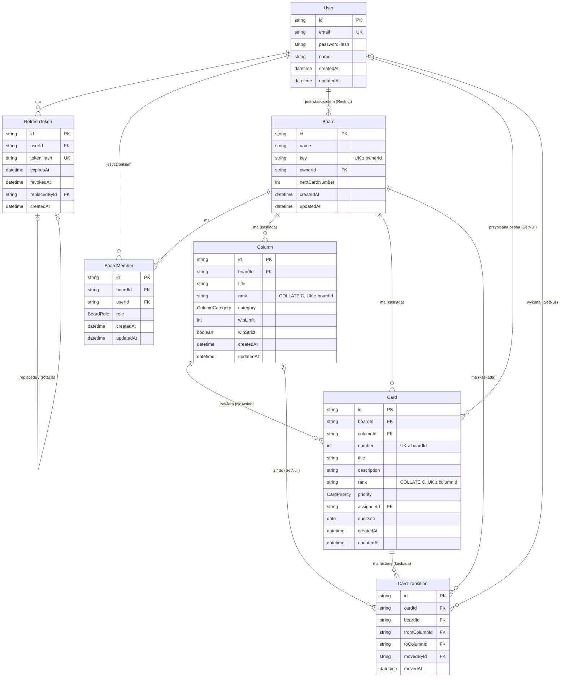

# Baza danych

Stan: M3a — modele `User`, `RefreshToken`, `Board`, `BoardMember`, `Column`, `Card`, `CardTransition`, enumy `BoardRole`, `ColumnCategory` i `CardPriority`; cztery migracje. Wstępny model docelowy: `docs/TECH_STACK.md`, sekcja 5.

## Diagram ER

## Konfiguracja
- PostgreSQL 18 uruchamiany przez `docker-compose.yml` (`postgres:18-alpine`); dane dostępowe z root `.env` (`POSTGRES_USER`, `POSTGRES_PASSWORD`, `POSTGRES_DB`, `POSTGRES_PORT`).
- Prisma 7.10.1: adres bazy w `apps/api/prisma.config.ts` (zmienna `DATABASE_URL` z `apps/api/.env`).
- Generator `prisma-client`, wyjście `apps/api/src/generated/prisma` (poza repozytorium; generowany w `postinstall` pakietu API).
- Połączenie przez `@prisma/adapter-pg`; klient tworzony w `apps/api/src/repositories/db.ts` (`createDbClient`), połączenie leniwe; w `server.ts` trafia do `createApp({ config, logger, db })`.
- Tylko repozytoria korzystają z Prisma.
- Testy integracyjne API używają osobnej bazy `streamline_test` (ADR-015). Adres: `DATABASE_URL_TEST` albo `DATABASE_URL` z dopiskiem `_test` do nazwy bazy; baza jest tworzona i migrowana automatycznie (`prisma migrate deploy` w `globalSetup`), a tabele są czyszczone (`TRUNCATE`) przed każdym testem. Nazwa bazy testowej musi kończyć się na `_test`. CI przekazuje `DATABASE_URL_TEST` i używa usługi PostgreSQL.

## Modele

### User
| Pole | Typ | Uwagi |
|---|---|---|
| `id` | String | PK, `cuid()` |
| `email` | String | unikalny; zapisywany znormalizowany (przycięty, małe litery) |
| `passwordHash` | String | hash bcrypt (bcryptjs) |
| `name` | String | |
| `createdAt` | DateTime | domyślnie `now()` |
| `updatedAt` | DateTime | `@updatedAt` |

Relacje: `refreshTokens` (1:N), `memberships` (1:N, `BoardMember`), `ownedBoards` (1:N, `Board.ownerId`), `assignedCards` (1:N, `Card.assigneeId`), `cardMoves` (1:N, `CardTransition.movedById`). Indeks: unikalny `User_email_key`.

### RefreshToken
| Pole | Typ | Uwagi |
|---|---|---|
| `id` | String | PK, `cuid()` |
| `userId` | String | FK → `User.id`, `onDelete: Cascade` |
| `tokenHash` | String | unikalny; SHA-256 (hex) nieprzezroczystego tokena — sam token nie jest przechowywany |
| `expiresAt` | DateTime | |
| `revokedAt` | DateTime? | ustawiane przy rotacji, wylogowaniu lub masowym unieważnieniu |
| `replacedById` | String? | unikalny FK → `RefreshToken.id` (`onDelete: SetNull`); token wydany w zamian przy rotacji |
| `createdAt` | DateTime | domyślnie `now()` |

Indeksy: unikalne `tokenHash` i `replacedById`, zwykły `userId`. Para `replacedById` ustawione i `revokedAt` niepuste odróżnia token wymieniony przy rotacji od unieważnionego wylogowaniem — to podstawa wykrywania ponownego użycia (ADR-013).

### BoardRole (enum)
`OWNER`, `ADMIN`, `MEMBER`, `VIEWER` (kolejność deklaracji decyduje o sortowaniu członków). Uprawnienia ról: `packages/shared/src/permissions.ts` (macierz w `docs/API.md`).

### Board
| Pole | Typ | Uwagi |
|---|---|---|
| `id` | String | PK, `cuid()` |
| `name` | String | 1–100 znaków (walidacja Zod) |
| `key` | String | prefiks kluczy kart (np. `SL`), 2–5 wielkich liter ASCII (walidacja Zod; w bazie bez `CHECK`) |
| `ownerId` | String | FK → `User.id`, `onDelete: Restrict`; użytkownik z członkostwem `OWNER` (serwis utrzymuje zgodność) |
| `nextCardNumber` | Int | domyślnie 1; numer dla następnej karty, tylko rośnie (numery się nie powtarzają) |
| `createdAt` | DateTime | domyślnie `now()` |
| `updatedAt` | DateTime | `@updatedAt`; zmienia się przy zmianie nazwy lub klucza (nie przy zwiększeniu licznika kart ani zmianach członków i zawartości) |

Relacje: `owner` (N:1), `members` (1:N), `columns`, `cards`, `transitions` (1:N, kaskada). Indeks: unikalny `Board_ownerId_key_key` (`ownerId`, `key`) — klucz jest unikalny w obrębie właściciela (ADR-046). Licznik `nextCardNumber` jest zwiększany w transakcji tworzenia karty pod blokadą wyłączną wiersza tablicy (ADR-043).

### BoardMember
| Pole | Typ | Uwagi |
|---|---|---|
| `id` | String | PK, `cuid()` |
| `boardId` | String | FK → `Board.id`, `onDelete: Cascade` |
| `userId` | String | FK → `User.id`, `onDelete: Cascade` |
| `role` | BoardRole | |
| `createdAt` | DateTime | domyślnie `now()`; data dołączenia |
| `updatedAt` | DateTime | `@updatedAt` |

Indeksy: unikalny `BoardMember_boardId_userId_key` (`boardId`, `userId`), zwykły `BoardMember_userId_idx`, oraz **częściowy unikalny** `BoardMember_one_owner_per_board` na `boardId` z warunkiem `WHERE "role" = 'OWNER'` — najwyżej jeden właściciel na tablicę. Indeks częściowy jest dopisany ręcznie w SQL migracji (Prisma go nie wyraża); co najmniej jednego właściciela zapewnia serwis (tablicę tworzy z właścicielem, właściciel nie może odejść ani zostać zmieniony). Patrz ADR-027.

Kaskady: usunięcie tablicy usuwa jej członkostwa, kolumny, karty i przejścia; usunięcie użytkownika usuwa jego członkostwa, a przy dodaniu usuwania kont trzeba zadbać o tablice bez właściciela — `Board.ownerId` ma `Restrict`, więc konto właściciela tablicy nie zostanie usunięte (ADR-046); karty i przejścia tracą wskazanie osoby (`SetNull`).

### ColumnCategory (enum)
`BACKLOG`, `TODO`, `IN_PROGRESS`, `DONE`. Analityka przepływu i reguły WIP opierają się na kategorii, nie na tytule kolumny (ADR-020).

### Column
| Pole | Typ | Uwagi |
|---|---|---|
| `id` | String | PK, `cuid()` |
| `boardId` | String | FK → `Board.id`, `onDelete: Cascade` |
| `title` | String | 1–100 znaków (walidacja Zod) |
| `rank` | String | `TEXT COLLATE "C"` (ręcznie w SQL migracji); klucz LexoRank liczony przez serwer |
| `category` | ColumnCategory | domyślnie `TODO` |
| `wipLimit` | Int? | `null` = brak limitu; zakres 1–999 pilnuje Zod |
| `wipStrict` | Boolean | domyślnie `false` |
| `createdAt` | DateTime | domyślnie `now()` |
| `updatedAt` | DateTime | `@updatedAt`; rebalansowanie rank go nie zmienia |

Indeks: ograniczenie `Column_boardId_rank_key` — `UNIQUE ("boardId", "rank") DEFERRABLE INITIALLY IMMEDIATE`; obsługuje też listowanie według rank. Zwykłe zapisy sprawdzają je po każdej instrukcji (czysty błąd P2002 → ponowienie), a rebalansowanie przepisuje wszystkie rank tablicy jednym `UPDATE ... FROM unnest(...)`, w którym wartości przejściowo mogą się pokrywać z rank innych wierszy. Collation `"C"` i odraczalność są dopisane ręcznie w migracji; Prisma ich nie porównuje, więc `prisma migrate dev` nie zgłasza dryfu (zweryfikowane). Patrz ADR-028, ADR-032.

Relacje: `cards` (1:N, `onDelete: NoAction`), `transitionsFrom`, `transitionsTo` (1:N, `SetNull` po stronie przejść).

Inwarianty poza bazą: co najmniej jedna kolumna `DONE` na tablicę (serwis + blokada wiersza tablicy, ADR-029); kolumna z kartami nie może być usunięta (409 `COLUMN_NOT_EMPTY` w serwisie pod blokadą wyłączną tablicy, dodatkowo klucz obcy `Card.columnId` bez akcji kaskadowej, ADR-047). Tablice sprzed migracji `20261111151836_columns` nie mają kolumn.

### CardPriority (enum)
`LOW`, `MEDIUM`, `HIGH`, `URGENT`.

### Card
| Pole | Typ | Uwagi |
|---|---|---|
| `id` | String | PK, `cuid()` |
| `boardId` | String | FK → `Board.id`, `onDelete: Cascade`; denormalizacja z kolumny (zapytania w obrębie tablicy, zakres kluczy) |
| `columnId` | String | FK → `Column.id`, `onDelete: NoAction` |
| `number` | Int | kolejny numer w tablicy z `Board.nextCardNumber`; klucz karty = `<Board.key>-<number>` składany przy odczycie |
| `title` | String | 1–200 znaków (walidacja Zod) |
| `description` | String? | do 10 000 znaków; pusty = `null` |
| `rank` | String | `TEXT COLLATE "C"` (ręcznie w SQL migracji); LexoRank liczony przez serwer |
| `priority` | CardPriority | domyślnie `MEDIUM` |
| `assigneeId` | String? | FK → `User.id`, `onDelete: SetNull`; osoba musi być członkiem tablicy (pilnuje serwis, ADR-045) |
| `dueDate` | Date? | `@db.Date`: data kalendarzowa bez czasu i strefy |
| `createdAt` | DateTime | domyślnie `now()` |
| `updatedAt` | DateTime | `@updatedAt`; rebalansowanie rank go nie zmienia |

Indeksy: unikalny `Card_boardId_number_key` (`boardId`, `number`); ograniczenie `Card_columnId_rank_key` — `UNIQUE ("columnId", "rank") DEFERRABLE INITIALLY IMMEDIATE` (jak `Column_boardId_rank_key`: zwykłe zapisy sprawdzają je po instrukcji, rebalansowanie przepisuje rank kolumny jednym `UPDATE ... FROM unnest(...)`; collation i odraczalność dopisane ręcznie w migracji); zwykły `Card_assigneeId_idx`.

### CardTransition
Rejestr każdego wejścia karty do kolumny (także utworzenia, z `fromColumnId = null`); źródło analityki przepływu (ADR-020). Zapisywany w tej samej transakcji co utworzenie lub przeniesienie, tylko przy zmianie kolumny.

| Pole | Typ | Uwagi |
|---|---|---|
| `id` | String | PK, `cuid()` |
| `cardId` | String | FK → `Card.id`, `onDelete: Cascade` |
| `boardId` | String | FK → `Board.id`, `onDelete: Cascade` |
| `fromColumnId` | String? | FK → `Column.id`, `onDelete: SetNull`; `null` przy utworzeniu karty lub po usunięciu kolumny |
| `toColumnId` | String? | FK → `Column.id`, `onDelete: SetNull`; zawsze zapisywany, `null` tylko po usunięciu kolumny |
| `movedById` | String? | FK → `User.id`, `onDelete: SetNull`; `null` po usunięciu konta |
| `movedAt` | DateTime | domyślnie `now()` |

Indeksy: `CardTransition_boardId_movedAt_idx` (`boardId`, `movedAt`), `CardTransition_cardId_movedAt_idx` (`cardId`, `movedAt`), `CardTransition_fromColumnId_idx`, `CardTransition_toColumnId_idx` (te dwa obsługują `ON DELETE SET NULL` przy usunięciu kolumny, bez nich skanowanie całej tabeli pod blokadą tablicy; przydadzą się też w analityce). Zapytania analityczne muszą uwzględniać `NULL` w kolumnach przejść (ADR-047).

## Migracje
| Migracja | Zawartość |
|---|---|
| `20261111010926_auth_users_refresh_tokens` | tabele `User` i `RefreshToken`, indeksy, klucze obce |
| `20261111143833_boards_members` | enum `BoardRole`, tabele `Board` i `BoardMember`, indeksy (w tym częściowy `BoardMember_one_owner_per_board`), klucze obce z kaskadą |
| `20261111151836_columns` | enum `ColumnCategory`, tabela `Column` (`rank TEXT COLLATE "C"`), odraczalne ograniczenie `Column_boardId_rank_key`, klucz obcy do `Board` z kaskadą |
| `20261112014500_cards_and_board_keys` | enum `CardPriority`; `Board.key`, `Board.ownerId` (dodane jako opcjonalne, uzupełnione blokiem PL/pgSQL, potem `NOT NULL`) i `Board.nextCardNumber`; tabele `Card` (`rank TEXT COLLATE "C"`, odraczalne `Card_columnId_rank_key`) i `CardTransition`; indeksy (w tym `Board_ownerId_key_key`), klucze obce (`Board.ownerId` `Restrict`, `Card.columnId` `NoAction`, kolumny i autor przejść `SetNull`) |

### Uzupełnienie istniejących tablic (migracja `20261112014500_cards_and_board_keys`)
Blok `DO` (znaczniki `backfill:begin`/`backfill:end` w pliku SQL; ten sam fragment uruchamia test `apps/api/src/test/board-key-backfill.test.ts` w wycofywanej transakcji) wykonuje kolejno: usunięcie tablic bez członków; nadanie roli `OWNER` najwyżej uprzywilejowanemu, najdawniej dołączonemu członkowi tablicy bez właściciela; ustawienie `ownerId` z członkostwa `OWNER`; wyliczenie `key` przybliżeniem generatora z `packages/shared` (transliteracja, inicjały, `BRD`; duplikaty jednego właściciela dostają sufiksy literowe). Liczby usuniętych tablic i awansowanych członków trafiają do logu migracji (`RAISE NOTICE`). Szczegóły i uzasadnienie: ADR-048. Migrację poprawiano w miejscu przed zmergowaniem — lokalna baza z wcześniejszym szkicem wymaga `prisma migrate reset`; po zmergowaniu migracji nie wolno już edytować.

Polecenia: `pnpm --filter @streamline/api db:migrate` (tworzy i stosuje migrację w środowisku deweloperskim), `prisma migrate deploy` (stosuje istniejące migracje; używane przez testy).

## Znane braki
- Wygasłe i unieważnione wiersze `RefreshToken` nie są usuwane (brak zadania czyszczącego).
